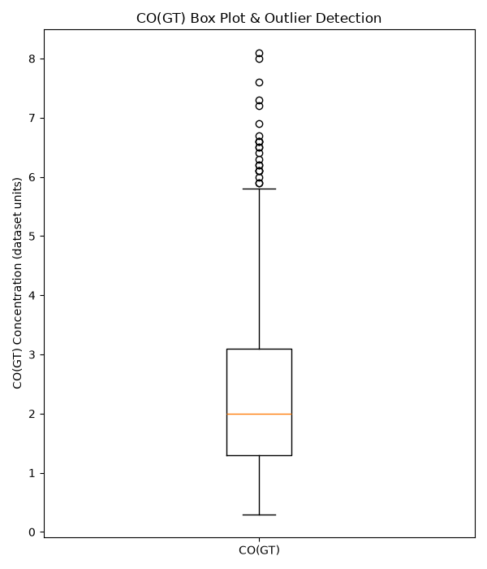
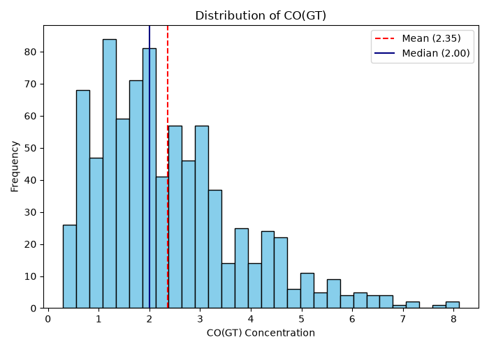
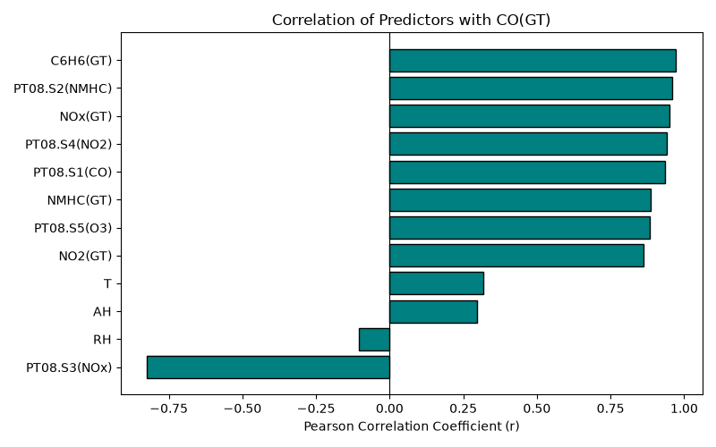
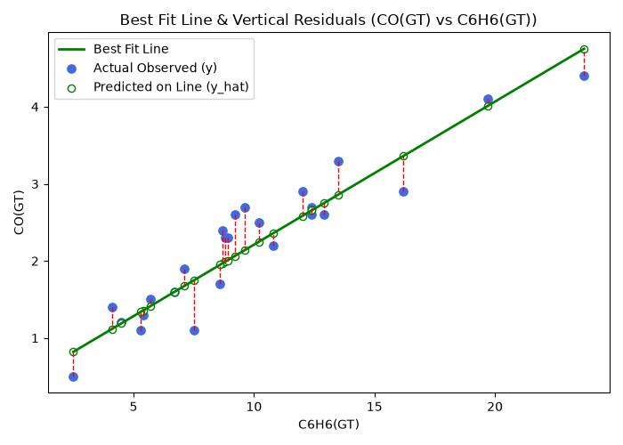
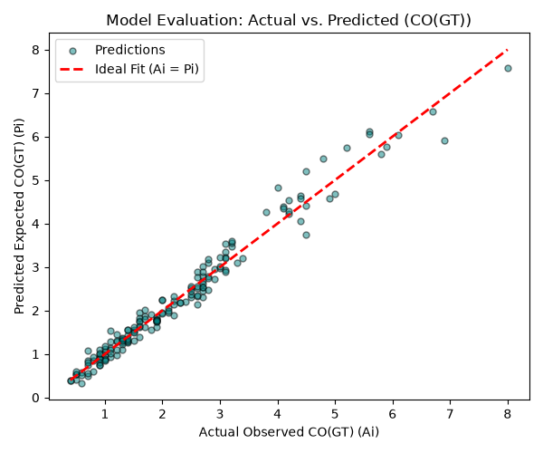
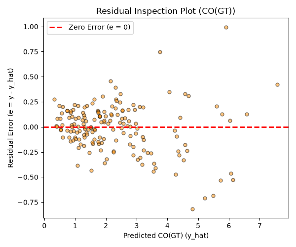
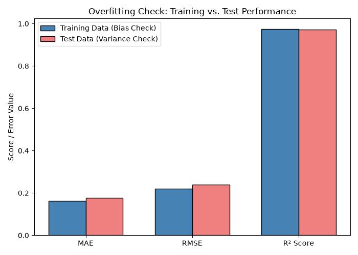

# Air Pollutant Predictor using Linear Regression

An educational machine-learning project that predicts air pollutant concentrations (e.g., CO / Benzene) from multi-sensor and meteorological data using linear regression (numpy,pandas, scikit-learn, matplotlib).
>**Important:** This is an academic demonstration, not an official predictor tool or decision support tool

## Team and roles

| Member | IIT ROPAR Entry no. | Role | GitHub Handle |
| :--- | :--- | :--- | :--- |
| Soham Gupta | 2026AIB1083 | Documentation lead | [@2026AIB1083-SOHAM](https://github.com/2026AIB1083-SOHAM) / [@sohamg9072](https://github.com/sohamg9072) |
| Amarpreet Singh | 2026EEB1318 | Execution lead | [@Amarpreet2026](https://github.com/Amarpreet2026) |
| Kedare Ashish Rajendra | 2026MCB1535 | PPT lead | [@2026mcb1535-star](https://github.com/2026mcb1535-star) |
| Nihal Krishna Chettebhaktula | 2026DAB1299 | Video lead | [@2026dab1299-ui](https://github.com/2026dab1299-ui) |


*All four members contributed code (see commit history).*
**GitHub repository:**
<https://github.com/2026AIB1083-SOHAM/ai101-team--42--air-pollutant-predictor.git>

## Project Overview

The project uses the UCI Air Quality dataset to build a **Multiple Linear Regression** model. The target column is `CO(GT)` (ground-truth Carbon Monoxide concentration in mg/m³).

The model uses all numeric sensor responses and ambient weather measurements as input features:

* `PT08.S1(CO)`
* `NMHC(GT)`
* `C6H6(GT)`
* `PT08.S2(NMHC)`
* `NOx(GT)`
* `PT08.S3(NOx)`
* `NO2(GT)`
* `PT08.S4(NO2)`
* `PT08.S5(O3)`
* `T` (Temperature)
* `RH` (Relative Humidity)
* `AH` (Absolute Humidity)

The model fits the parametric equation $y = b_0 + b_1 x_1 + b_2 x_2 + \dots + b_{12} x_{12}$ and outputs a continuous predicted pollutant concentration ($\hat{y} \in \mathbb{R}$).

## Dataset

The supplied CSV file is `air_quality.csv` located in the `data/` directory.

* **Rows:** 9,357 hourly sensor records (8,991 retained after removing missing records)
* **Columns:** 15 raw attributes (12 numeric input features + 1 continuous target)
* **Target:** `CO(GT)`
* **Missing values:** Handled by replacing the UCI sensor fault sentinel code (`-200`) with `NaN` and dropping invalid entries.

The codebase expects `air_quality.csv` to be in the `data/` directory. Do not alter the directory structure or file names.

## Project structure

```text
ai101-team-42-air-pollutant-predictor/
├── data/
│   └── air_quality.csv          # 9,357 rows, UCI multi-sensor & meteorological data
├── outputs/                     # 7 generated evaluation plots saved here
├── src/
│   ├── cleaning.py              # data ingestion and cleaning
│   ├── visualization.py         # 1.5*IQR outlier boxplot & correlation analysis
│   ├── regression_model.py      # Parametric OLS Linear Regression training
│   ├── model_evaluation.py      # Evaluation metrics (MAE, RMSE, R²) & residual plots
│   └── main.py                  # Entry point orchestrating full pipeline
├── .gitignore                   
├── requirements.txt             # Pinned package dependencies
└── README.md                    # Documentation & reproducibility instructions
```
## Setup

Tested on Python 3.10, 3.11, and 3.14 (Windows, Ubuntu).

#### 1. Clone the repository
"Please run the code one line at a time"

```bash
git clone https://github.com/2026AIB1083-SOHAM/ai101-team--42--air-pollutant-predictor.git
cd ai101-team--42--air-pollutant-predictor
```

### 2. Create and activate a virtual environment

**Windows (Command Prompt):**

``` bat
py -m venv .venv
.venv\Scripts\activate
```

**Windows (PowerShell):**

``` powershell
py -m venv .venv
.\.venv\Scripts\Activate.ps1
```

**macOS / Linux:**

``` bash
python3 -m venv .venv
source .venv/bin/activate
```

### 3. Install dependencies

``` bash
python3 -m pip install --upgrade pip
python3 -m pip install -r requirements.txt
```

### How to run

1. Run the complete pipeline from the project root directory:

   ```bash
   python src/main.py
   ```

2. The script automatically executes data ingestion and cleaning, IQR outlier detection, linear regression model training, metric evaluation (MAE, MSE, RMSE, R²), and exports 7 plots into `outputs/`.

3. Expected runtime: under 35 seconds.

## Model Results

The model was executed with the supplied dataset (`data/air_quality.csv`) and the dependency versions listed in `requirements.txt`. With an 80/20 train/test split (random seed `42`) and median binarization threshold, the testing results were:

| Metric | Test result |
| :--- | ---: |
| MAE | 0.1779 |
| MSE | 0.0579 |
| RMSE | 0.2407 |
| R² | 0.9722 |

## Visualizations & Model Diagnostics

### 1. Box Plot & Outlier Detection


*Identifies extreme target observations using the IQR rule and illustrates distribution spread.*

---

### 2. Target Concentration Distribution


*Visualizes target variable frequency, skewness, and the positioning of the dataset mean versus median.*

---

### 3. Feature Correlations with Target


*Ranks predictors by their Pearson correlation coefficient to identify the strongest linear relationships with the target.*

---

### 4. Best Fit Line & Vertical Residuals


*Shows the 2D parametric regression line against observed data points, highlighting individual vertical residual errors.*

#### Interpretation of the Plot
* **Parametric Best Fit Line ($y = b_0 + b_1 x$):** The green line represents the Ordinary Least Squares (OLS) fitted regression model between the primary predictor Benzene concentration (`C6H6(GT)`) and the target Carbon Monoxide concentration (`CO(GT)`).
* **Observed vs. Predicted:** The blue markers represent the actual observed sensor values ($y_i$), while the hollow green circles on the regression line indicate the model's fitted predictions ($\hat{y}_i$).
* **Vertical Residual Errors ($e_i = y_i - \hat{y}_i$):** The red dashed vertical lines illustrate individual prediction residuals (errors). Points located above the green line show positive residuals (underestimation), while points below show negative residuals (overestimation). 
* **Model Fit:** The tight clustering of data points along the linear trajectory demonstrates a strong positive linear correlation ($r$), confirming that sensor response to Benzene provides a reliable linear indicator for Carbon Monoxide concentration.
---

### 5. Actual vs. Predicted Evaluation


*Plots test set predictions against ground truth values alongside the ideal 1:1 reference line to assess prediction alignment.*

---

### 6. Residual Diagnostics


*Inspects prediction errors across predicted values to confirm random scatter around zero and check for heteroscedasticity.*

---

### 7. Training vs. Test Overfitting Check


*Compares error and determination metrics across training and test splits to verify model generalization and check the bias-variance trade-off.*


## Presentation and Video

- **Project Presentation (PPT):** [Click Here to View PPT](https://drive.google.com/file/d/1nAkrtIHxCBxYiw0xB-9NpIdtlfVoJB6w/view?usp=sharing)
- **Project video:**
  [Click Here to View Video]
  (https://youtu.be/IL5ETSUc3uk)


## AI-Use Disclosure

Gemini (Google) was used to assist with drafting and organising this
README and reviewing the project files for documentation details, and was also used to research for the os and sys python libraries that make the code more robust . The
project description, repository instructions, and reported metrics were
checked against the supplied code files and dataset; the code files were also
executed to verify that it runs with the pinned dependencies listed in
`requirements.txt`. Additionally gemini was used to refine the comments in the code files.

Claude (Anthropic) was used to refine the model training and evaluation process.
